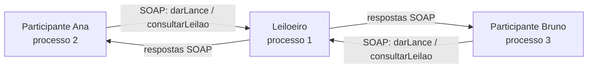

# Leilão distribuído com SOA/SOAP — Grupo 2

**PUC-SP, Sistemas Distribuídos e Computação Paralela, 2026.**

**Integrantes:** Cesar Silva, Hélio Sueta, Nicolas Silva, Patrick Barreira e Pedro Yoshissaro.

**Entrega 2 (06/11/2026):** código da POC, instruções, experimentos locais e slides do seminário.

## O que a POC demonstra

Um processo **Leiloeiro** mantém o estado de um item. Dois ou mais processos **Participantes** enviam lances e consultam o estado. O servidor expõe as operações em **WSDL 1.1** e troca mensagens **SOAP 1.1/XML sobre HTTP**. O cliente Zeep lê o WSDL e constrói as chamadas. A operação `darLance` é síncrona, com resposta de aceite ou recusa. Cada Participante descobre novos maiores lances e o vencedor por **consulta periódica** (`polling`), conforme o cenário SOAP da especificação.



O Leiloeiro decide a ordem efetiva dos lances. Um `Lock` protege a verificação e a atualização do maior valor; dois lances iguais quase simultâneos produzem um aceite e uma recusa. Os valores são inteiros em **centavos**. O prazo usa o relógio UTC do servidor. O estado está em memória: ao reiniciar o Leiloeiro, começa um novo leilão.

## Instalação

Requer Python 3.11 ou mais recente. Em PowerShell, na raiz do repositório:

```powershell
python -m venv .venv
.\.venv\Scripts\python.exe -m pip install -r requirements.txt
```

Em Linux ou macOS, use `python3 -m venv .venv` e `.venv/bin/python -m pip install -r requirements.txt`. As dependências são Spyne (servidor SOAP) e Zeep (cliente SOAP).

## Demonstração em três terminais

**Terminal 1, Leiloeiro:**

```powershell
.\.venv\Scripts\python.exe leiloeiro.py --host 127.0.0.1 --porta 8000 --duracao-segundos 60
```

**Terminal 2, Participante Ana:**

```powershell
.\.venv\Scripts\python.exe participante.py participar Ana --intervalo 1
```

**Terminal 3, Participante Bruno:**

```powershell
.\.venv\Scripts\python.exe participante.py participar Bruno --intervalo 1
```

Digite `1500` no terminal de Ana e `2000` no de Bruno. Cada processo imprime o novo maior lance após sua próxima consulta. Quando passar a duração de 60 segundos, ambos imprimem `Vencedor: Bruno com 2000 centavos`. O comando `sair` fecha um Participante. O servidor aceita `Ctrl+C` para encerrar.

Também existem comandos de uma chamada, úteis para testar o serviço:

```powershell
.\.venv\Scripts\python.exe participante.py lance Ana 1500
.\.venv\Scripts\python.exe participante.py consultar
.\.venv\Scripts\python.exe participante.py acompanhar --intervalo 1 --limite-segundos 90
```

O WSDL pode ser inspecionado em `http://127.0.0.1:8000/?wsdl`.

### Execução em duas máquinas

Na máquina do Leiloeiro, use `--host 0.0.0.0` e confirme que a porta TCP 8000 está liberada na rede local. Nas máquinas dos Participantes, passe a URL antes do subcomando:

```powershell
.\.venv\Scripts\python.exe participante.py --url "http://IP_DO_LEILOEIRO:8000/?wsdl" participar Ana
```

Na segunda máquina, abra primeiro `http://IP_DO_LEILOEIRO:8000/?wsdl` para conferir a conectividade. **A execução entre duas máquinas ainda não foi verificada neste ambiente**; ela deve ser feita com os notebooks do grupo no laboratório para confirmar RE1.

## Contrato e mensagens

| Operação | Entrada | Saída |
| --- | --- | --- |
| `darLance` | `participante: string`, `valor_centavos: integer` | `aceito: boolean`, `mensagem: string`, `maior_lance_centavos: integer`, `lider: string` |
| `consultarLeilao` | nenhuma | `descricao: string`, `lance_minimo_centavos: integer`, `maior_lance_centavos: integer`, `lider: string`, `segundos_restantes: integer`, `encerrado: boolean` |

O WSDL gerado em `/?wsdl` contém tipos, operações e endereço do serviço. As requisições são envelopes SOAP 1.1 com corpo XML. Exemplo de lance:

```xml
<soapenv:Envelope xmlns:soapenv="http://schemas.xmlsoap.org/soap/envelope/"
                  xmlns:lei="urn:grupo2:leilao:soap">
  <soapenv:Body>
    <lei:darLance>
      <lei:participante>Ana</lei:participante>
      <lei:valor_centavos>1500</lei:valor_centavos>
    </lei:darLance>
  </soapenv:Body>
</soapenv:Envelope>
```

O exemplo mostra a estrutura; o WSDL publicado pelo servidor é a referência para os namespaces e elementos exatos. A resposta de `darLance` indica aceite e maior lance corrente. O Participante consulta `consultarLeilao` a cada segundo e imprime apenas mudanças no maior lance ou no estado de encerramento. Quando `encerrado=true`, anuncia o vencedor; se ninguém ofertou, anuncia encerramento sem vencedor. Novos lances após o prazo são recusados.

## Experimentos executados em 06/11/2026

Os testes abaixo usam **processos distintos na mesma máquina**. Para reproduzir:

```powershell
.\.venv\Scripts\python.exe -m unittest discover -s tests -v
```

| Experimento | Procedimento e resultado observado | Explicação |
| --- | --- | --- |
| Polling e encerramento | Dois observadores receberam os maiores lances de Ana (1.500) e Bruno (2.000), anunciaram Bruno como vencedor; um lance de 3.000 após o prazo foi recusado. | Os Participantes fazem consultas SOAP periódicas; o servidor compara o prazo antes de aceitar um lance. |
| Falha e reinício | Após um lance de 1.500, o Leiloeiro foi encerrado. Uma consulta retornou erro de comunicação. Reiniciado na mesma porta, respondeu com maior lance 0. | A falha impede novas chamadas; o estado em memória se perde no reinício. O modo `participar` avisa da indisponibilidade e tenta consultar novamente. |
| Concorrência | Dois processos enviaram 1.500 quase ao mesmo tempo. Bruno recebeu `aceito=True`; Ana recebeu `aceito=False`; o estado final ficou em 1.500 com Bruno líder. | O `Lock` serializa a decisão. O nome do vencedor desta disputa depende da ordem em que as chamadas entram no servidor; em outra execução, Ana pode vencer. |

Execução local: **3 testes passaram**. A execução em duas máquinas (RE1) e a observação manual no laboratório permanecem pendentes.

## Requisitos e limites

| Requisito | Situação |
| --- | --- |
| RF1: Leiloeiro e dois Participantes em processos distintos | Implementado e testado localmente; testar entre máquinas para RE1. |
| RF2: item, mínimo, prazo e consulta | Implementado. `--descricao`, `--minimo-centavos` e `--duracao-segundos` configuram o leilão. |
| RF3: aceitar apenas lance superior | Implementado e testado. |
| RF4: todos percebem novo maior lance | Implementado por polling e testado com dois observadores. |
| RF5: encerrar, recusar e anunciar vencedor | Implementado e testado. |
| RF6: formato documentado | WSDL e SOAP/XML descritos acima. |
| RE2: falha | Testado localmente; sem persistência no reinício. |
| RE3: concorrência | Testado localmente com dois processos. |
| RE4: GitHub, README, IA.md e slides | Arquivos presentes neste repositório. |

Esta POC não implementa autenticação, persistência nem replicação. A frequência de polling define um atraso de até aproximadamente um intervalo para perceber novidades e gera consultas mesmo quando nada muda. Uma falha do Leiloeiro deixa o serviço indisponível até reinício.

## Roteiro do seminário

Os slides estão em [`slides/Seminario_Grupo_2_SOAP.pptx`](slides/Seminario_Grupo_2_SOAP.pptx). Em cerca de 10 minutos: explicar SOAP/WSDL e polling, mostrar a arquitetura, executar os três terminais, comentar falha e concorrência, apresentar o registro de IA e concluir. Todos os integrantes devem saber explicar o código e os resultados.

## Referências

- [W3C — WSDL 1.1](https://www.w3.org/TR/wsdl.html)
- [W3C — SOAP 1.1](https://www.w3.org/TR/2000/NOTE-SOAP-20000508/)
- [Spyne — documentação](https://spyne.io/docs/)
- [Zeep — cliente e WSDL](https://docs.python-zeep.org/en/master/client.html)
- [Salesforce — SOAP API e WSDL empresarial](https://developer.salesforce.com/docs/platform/api/guide/sforce-api-partner.html). Exemplo real de API com contrato formal; não é parte da POC.

## Divisão de tarefas proposta na Entrega 1

| Integrante | Frente principal |
| --- | --- |
| Cesar Silva | Servidor SOAP e contrato WSDL |
| Hélio Sueta | Cliente SOAP e polling |
| Nicolas Silva | Concorrência e validação com dois Participantes |
| Patrick Barreira | GitHub, README e teste entre máquinas |
| Pedro Yoshissaro | Pesquisa, experimento de falha e slides |

O grupo pode ajustar essa divisão. O arquivo [`IA.md`](IA.md) registra o uso de IA e a revisão crítica.
