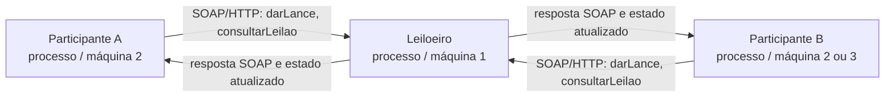

# Grupo 2 — POC de leilão distribuído com SOA/SOAP

**Disciplina:** Sistemas Distribuídos e Computação Paralela — PUC-SP, 2º semestre de 2026

**Entrega 1 (30/10/2026):** roteiro preliminar, divisão de tarefas e primeira comunicação entre processos.

**Integrantes:** Cesar Silva, Hélio Sueta, Nicolas Silva, Patrick Barreira e Pedro Yoshissaro.

## Tecnologia e objetivo

O grupo usa **SOA/SOAP**, no paradigma de **web services**. O Leiloeiro publica operações em um contrato **WSDL 1.1**. Os Participantes obtêm esse contrato e enviam mensagens **SOAP 1.1 em XML sobre HTTP**. A chamada `darLance` é requisição/resposta síncrona. Para a notificação dos novos maiores lances, o desenho prevê **polling**: cada Participante chama `consultarLeilao` em intervalos regulares e imprime mudanças no console. Isso mantém a comunicação simples, mas acrescenta atraso de até um intervalo de consulta e chamadas mesmo sem mudanças.

O protótipo usa Python, [Spyne](https://spyne.io/docs/) no servidor e [Zeep](https://docs.python-zeep.org/en/master/) no cliente. O WSDL é gerado pelo servidor; o cliente o lê antes de chamar as operações. O servidor é a autoridade sobre o estado e a ordem dos lances. A escolha de centavos inteiros evita arredondamento de valores monetários em ponto flutuante.

### Arquitetura preliminar



- **Quem inicia:** cada Participante inicia as requisições. O Leiloeiro apenas responde.
- **Contrato:** `http://HOST:8000/?wsdl`; endpoint SOAP no mesmo host e porta.
- **Estado inicial:** um item, lance mínimo de 1.000 centavos e duração de 300 segundos, configuráveis na linha de comando.
- **Consistência inicial:** um `Lock` serializa as atualizações do maior lance dentro do Leiloeiro. A ordem observada é a de entrada na seção crítica, não a do relógio do Participante.
- **Limitação deliberada da POC:** o estado está em memória; reiniciar o Leiloeiro inicia um novo leilão. A demonstração de falha deve registrar esse comportamento.

## Contrato e formato das mensagens

O WSDL define estas operações e tipos:

| Operação | Entrada | Saída |
| --- | --- | --- |
| `darLance` | `participante: string`, `valor_centavos: integer` | `aceito: boolean`, `mensagem: string`, `maior_lance_centavos: integer`, `lider: string` |
| `consultarLeilao` | nenhuma | `descricao: string`, `lance_minimo_centavos: integer`, `maior_lance_centavos: integer`, `lider: string`, `segundos_restantes: integer`, `encerrado: boolean` |

As mensagens são XML com `Envelope` e `Body` SOAP 1.1. O esquema exato, inclusive namespaces e nomes de elementos, é publicado pelo WSDL gerado em `/?wsdl`. Exemplo ilustrativo do corpo de uma requisição:

```xml
<soapenv:Envelope xmlns:soapenv="http://schemas.xmlsoap.org/soap/envelope/"
                  xmlns:lei="urn:grupo2:leilao:soap">
  <soapenv:Body>
    <lei:darLance>
      <lei:participante>Ana</lei:participante>
      <lei:valor_centavos>1500</lei:valor_centavos>
    </lei:darLance>
  </soapenv:Body>
</soapenv:Envelope>
```

## Primeira comunicação entre dois processos

Pré-requisitos: **Python 3.11+**, acesso à porta TCP 8000 e dependências de `requirements.txt`.

```powershell
python -m venv .venv
.\.venv\Scripts\python.exe -m pip install -r requirements.txt
```

Terminal 1 — Leiloeiro:

```powershell
.\.venv\Scripts\python.exe leiloeiro.py --host 127.0.0.1 --porta 8000
```

Terminal 2 — Participante, em outro processo:

```powershell
.\.venv\Scripts\python.exe participante.py lance Ana 1500
.\.venv\Scripts\python.exe participante.py lance Bruno 1200
.\.venv\Scripts\python.exe participante.py consultar
```

O primeiro lance deve ser **aceito**. O de Bruno deve ser **recusado**, pois não supera 1.500 centavos. A consulta deve indicar Ana como líder. Para rodar entre duas máquinas, inicie o Leiloeiro com `--host 0.0.0.0`, libere a porta 8000 na rede local e, no cliente, use `--url http://IP_DO_LEILOEIRO:8000/?wsdl` **antes** de `lance` ou `consultar`. Testar primeiro o WSDL no navegador da segunda máquina ajuda a separar problemas de rede dos de SOAP.

**Estado da Entrega 1:** servidor e cliente cobrem a troca inicial de lance e a consulta. A execução entre duas máquinas e com dois Participantes simultâneos fica para validação em laboratório. Polling contínuo, anúncio automático do vencedor e experimentos ficam no roteiro abaixo.

**Verificação local em 30/10/2026:** o WSDL respondeu e três chamadas SOAP, feitas de outro processo, produziram `aceito=True` para Ana/1.500, `aceito=False` para Bruno/1.200 e `lider=Ana` na consulta. Esse teste foi feito em uma única máquina; RE1 ainda precisa ser observado no laboratório.

## Roteiro de implementação e validação

| Quando | Trabalho e critério de pronto |
| --- | --- |
| 30/10, laboratório 1 | Entender SOA, SOAP e WSDL; fixar arquitetura; instalar dependências; executar `darLance` entre dois processos; publicar este README e o código no GitHub. |
| 06/11, início | Executar 1 Leiloeiro e 2 Participantes; implementar consulta periódica com aviso apenas quando o maior lance mudar; anunciar resultado final e recusar lances depois do prazo. Validar RF1–RF6. |
| 06/11, meio | Rodar em pelo menos duas máquinas. Encerrar o Leiloeiro, observar erro no cliente e reiniciá-lo; registrar que o estado em memória se perde. Enviar lances quase simultâneos e explicar a decisão do `Lock`. Validar RE1–RE3. |
| 06/11, fim | Completar instruções de execução, registrar resultados reais dos experimentos, preparar slides e um vídeo curto da demonstração. |
| 13/11 | Apresentar conceito, arquitetura, demonstração, falha, concorrência, uso crítico de IA e conclusão; manter os slides no repositório antes do seminário. |

### Divisão de tarefas proposta

| Integrante | Responsabilidade principal | Revisão cruzada |
| --- | --- | --- |
| Cesar Silva | Servidor SOAP: contrato WSDL, estado e encerramento | Revisar cliente e comandos de execução |
| Hélio Sueta | Cliente SOAP: consulta periódica e exibição de atualizações | Revisar contrato e mensagens XML |
| Nicolas Silva | Testes com dois Participantes e experimento de concorrência | Revisar tratamento de falhas |
| Patrick Barreira | Integração GitHub, README e execução entre duas máquinas | Revisar passos de instalação com o grupo |
| Pedro Yoshissaro | Pesquisa de SOA/SOAP, slides e experimento de falha | Revisar explicação de latência e polling |

Todos devem conseguir explicar o contrato, o fluxo de mensagens, o código e os resultados. A distribuição pode ser ajustada pelo grupo no laboratório.

## Critérios de aceitação para a POC completa

- **RF1–RF3:** um Leiloeiro e dois Participantes em processos distintos; item, mínimo e prazo; consulta; lance aceito ou recusado.
- **RF4–RF5:** cada Participante percebe novos maiores lances pelo polling e o encerramento com vencedor; lances tardios são recusados.
- **RF6:** WSDL e XML/SOAP documentados aqui.
- **RE1–RE3:** execução em duas máquinas, experimento de falha e lances simultâneos com observações reais anotadas neste README após os testes.
- **RE4:** código, instruções, `IA.md` e slides no GitHub.

## Estudo preliminar: vantagens, limites e referências

O contrato WSDL explicita operações, tipos e endpoint e permite que um cliente gere chamadas a partir dele. XML/SOAP facilita a integração quando sistemas heterogêneos precisam de um contrato formal. O custo é maior volume de mensagens e maior acoplamento ao contrato e à disponibilidade do serviço. Nesta POC, o polling ainda troca latência por frequência de consultas; se o Leiloeiro cair, os Participantes não conseguem consultar ou ofertar até ele voltar.

Referências consultadas:

- [W3C — Web Services Description Language (WSDL) 1.1](https://www.w3.org/TR/wsdl.html)
- [W3C — SOAP 1.1](https://www.w3.org/TR/2000/NOTE-SOAP-20000508/)
- [Spyne — documentação](https://spyne.io/docs/)
- [Zeep — cliente e carregamento do WSDL](https://docs.python-zeep.org/en/master/client.html)

Casos de uso reais em empresas serão incluídos nos slides somente depois de verificação em fontes próprias das organizações citadas.
